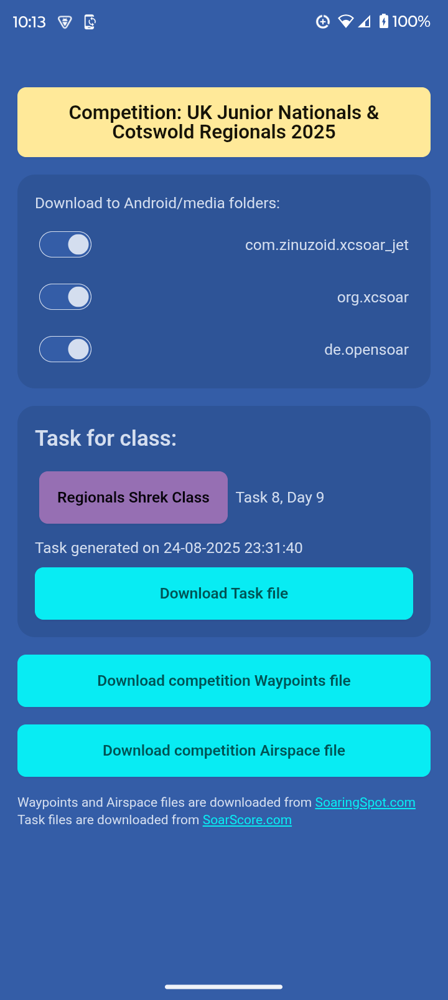
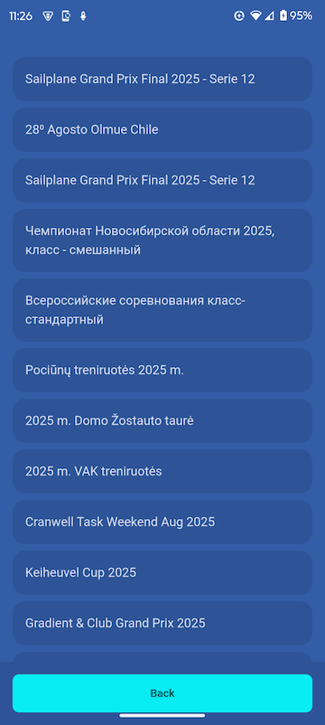

# XComps

XComps is a gliding competition manager for Android that can download **task**, **waypoint** and **airspace** files from ongoing competitions into **XCSoar** and its related forks.
It was inspired by Kedder's [**Compman**](https://github.com/kedder/openvario-compman) for the OpenVario.

It searches the `Android/media` folder for sub-folders containing "soar" in their name and lets you choose which ones to download to.
Then it places the downloaded files into the folders you selected.

The files for tasks, waypoints and airspaces are named `xcomps_task.tsk`, `xcomps_waypoints.cup` and `xcomps_airspace.txt`, respectively.<br>
The files are overwritten each time you download a new one.

You can download the `.apk` file from the [**Releases**](https://github.com/DanielDe8/xcomps/releases) tab.

For maintainers: see [RELEASE.md](./RELEASE.md) for Android APK signing, GitHub Actions setup, and release instructions.

**Warning**: this app may not work with older versions of XCSoar, because they don't store their data in the `Android/media` folder.<br>
It is recommended to use the latest version of XCSoar, available at [https://xcsoar.org/download](https://xcsoar.org/download)

Waypoint and Airspace files are downloaded from [SoaringSpot.com](https://soaringspot.com)
Tasks are generated using the [GlideAndSeek API](https://api.glideandseek.com/v2/task)<br>

## Import a task QR code

Use **Import task QR code from camera** for automatic capture, or **Import task QR code from files** to select an image from Downloads, Photos or another available provider. No competition needs to be selected. With a competition selected, the buttons appear side by side and the selection is retained after import.

Review the decoded point order, coordinates, elevations and sector dimensions; acknowledge any conversion notes, select the Android/media destinations, and press **Save & Import to XCSoar**. XComps writes `xcomps_task.tsk` and returns home after every selected destination succeeds. On partial failure it stays on the review screen and identifies failed destinations so you can retry. Load the saved task in XCSoar to activate it, as with downloaded competition tasks.

Supported: XCTrack CLASSIC v1/v2 (`XCTSK:`), zlib/base64 `XCTSKZ:`, waypoint routes (with explicit default-sector notes), and the SeeYou `na_o` line, cylinder, symmetric sector and supported keyhole encodings. Scanning and decoding happen on the device without uploading photos. The three supplied SeeYou public task examples are covered by image fixtures, including Latin-1 waypoint names.

Start gates/timing, separate ESS scoring and goal deadlines are shown/disclosed but are not applied to XCSoar. Unsupported task types (including unverified AAT encodings), manufacturer extensions, earth models and sector combinations are rejected. QR codes containing a web link instead of task data show instructions to obtain SeeYou's **Share → Mobile** task QR.

## Development checks

```sh
npm ci
npm test
npm run cap_build
cd android
./gradlew assembleDebug
```

For manual browser integration tests, run `npm run dev` and open `/tests/ui.html`. This harness simulates Android folders and a camera feed using a real sample QR; it can exercise permission denial, partial writes and preference persistence without changing device files. It is excluded from the production build. See [QR validation](docs/qr-validation.md) for coverage and remaining device checks.

The separate [iOS feasibility assessment](docs/ios-feasibility.md) describes a proposed one-time folder selection with persistent access, plus export/share fallbacks. No iOS build is included in this change.

## Screenshots


